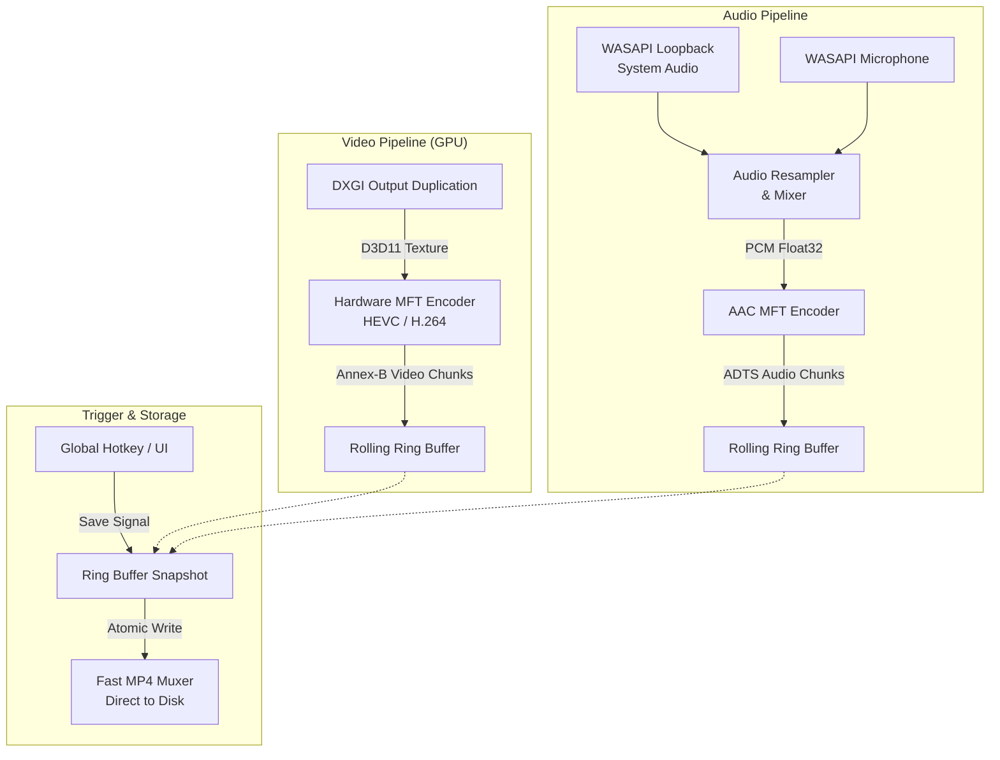

<div align="center">

  

  # OmniClip

  **Ultra-lightweight, hardware-accelerated Instant Replay & Screen Capture for Windows.**  
  *Written entirely in 100% safe, high-performance Rust.*

  <p align="center">
    <a href="https://github.com/norz3n/OmniClip/releases"></a>
    <a href="https://github.com/norz3n/OmniClip/actions/workflows/release.yml"></a>
    
    
    
    <a href="LICENSE"></a>
  </p>

  <p align="center">
    <a href="#-key-features">Key Features</a> •
    <a href="#-installation--downloads">Download</a> •
    <a href="#-hotkeys">Hotkeys</a> •
    <a href="#%EF%B8%8F-architecture">Architecture</a> •
    <a href="#%EF%B8%8F-building-from-source">Build from Source</a>
  </p>

</div>

---

## ⚡ Why OmniClip?

Unlike heavy streaming software or proprietary overlay bundles, **OmniClip** is focused purely on **instant replay and screenshot capture** with near-zero system overhead:

* 🚀 **Zero CPU Bottleneck** — Frame capture and encoding happen entirely on your GPU via DXGI and hardware MFT (NVENC / AMF / Intel QSV).
* 💾 **Zero SSD Thrashing** — Rolling replay buffers live exclusively in your system RAM and are keyframe-aligned. Your disk is only written to when you press Save.
* 🪶 **Featherweight footprint** — Native Win32 binary starts in under **80 ms** with minimal RAM usage.
* 🔒 **Clean & Self-Contained** — No accounts, no background telemetry, no telemetry services.

---

## ✨ Key Features

| Feature | Description |
| :--- | :--- |
| **DirectX 11 & DXGI Duplication** | Hardware zero-copy desktop and fullscreen game capture with sub-millisecond frame acquisition. |
| **HEVC & H.264 Hardware Encoding** | Next-gen **H.265 (HEVC)** encoding with seamless automatic fallback to **H.264 (AVC)** via Windows Media Foundation. |
| **RAM Rolling Ring Buffer** | Keep between **15 seconds and 20 minutes** of pristine gameplay in RAM with IDR keyframe pruning. |
| **WASAPI Multi-Source Audio** | Simultaneous capture of default speakers/headphones and microphone with real-time resampling and stereo downmixing. |
| **Interactive Hotkey Recorder** | Fully customizable global shortcuts with visual keycap badges and low-level Win32 keyboard hooks. |
| **Multi-Monitor Display Switcher** | Runtime display enumeration and instantaneous monitor switching without restarting the capture engine. |
| **Material 3 / Fluent UI** | Smooth dark and light themes powered by `egui`, featuring Montserrat typography and Segoe MDL2 iconography. |
| **System Tray & Autostart** | Background operation with tray minimization, Windows Registry autostart toggle, Explorer reveal, and default player playback. |
| **Bilingual Support** | Built-in native English and Russian interface localization. |

---

## ⌨️ Default Hotkeys

All hotkeys can be rebound directly from the **Settings** tab with interactive key combination recording.

| Action | Default Shortcut | Description |
| :--- | :---: | :--- |
| **Save Instant Replay** | <kbd>F9</kbd> | Flushes the buffered rolling video from RAM to a `.mp4` file |
| **Instant Screenshot** | <kbd>F10</kbd> | Captures the current display frame to `.png` and copies to clipboard |
| **Toggle OmniClip Window** | <kbd>Ctrl</kbd> + <kbd>Shift</kbd> + <kbd>O</kbd> | Shows or hides the application dashboard |

---

## 🏗️ Architecture

OmniClip is organized into decoupled, high-performance modular pipelines:



---

## 📦 Installation & Downloads

Pre-built binaries for **Windows 10 & 11 (64-bit)** are available on the [**GitHub Releases**](https://github.com/norz3n/OmniClip/releases) page:

1. **Inno Setup Installer** (`OmniClip_Setup_x.x.x.exe`) — Standard clean Windows setup with Start Menu shortcut, desktop icon, and uninstaller.
2. **Portable ZIP** (`OmniClip_vx.x.x_Portable.zip`) — Extract anywhere and run without installation.

---

## 🛠️ Building from Source

### Prerequisites

* **Operating System**: Windows 10 (Version 1809+) or Windows 11
* **Rust**: 1.75+ (MSVC toolchain recommended: `x86_64-pc-windows-msvc`)
* **Graphics**: GPU supporting DirectX 11 Feature Level 11_0+
* **Inno Setup 6 / 7** *(optional, only for building the installer)*

### Steps

```powershell
# 1. Clone the repository
git clone https://github.com/norz3n/OmniClip.git
cd OmniClip

# 2. Run automated test suite
cargo test

# 3. Build optimized release binary
cargo build --release

# The compiled executable will be located at:
# target/release/omni_clip.exe
```

### Packaging the Inno Setup Installer

```powershell
# Compile the installer using the preprocessor version parameter
iscc /DMyAppVersion=0.2.2 installer/omniclip_setup.iss

# Generated installer:
# dist/OmniClip_Setup_0.2.2.exe
```

---

## 📋 System Requirements

* **OS**: Windows 10 (build 17763+) or Windows 11 (x64)
* **GPU**: Any modern NVIDIA (NVENC), AMD (AMF/VCE), or Intel (QuickSync) graphics processor
* **RAM**: 4 GB minimum (approx. 300 MB - 1.2 GB dedicated for rolling video buffers depending on resolution & duration)

---

## 📜 License

OmniClip is distributed under the **MIT License**. See [LICENSE](LICENSE) for details.
